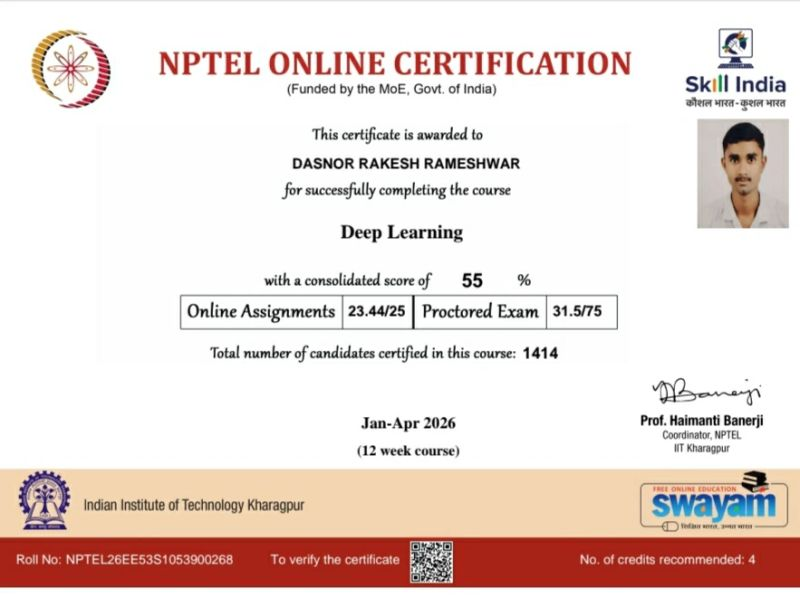
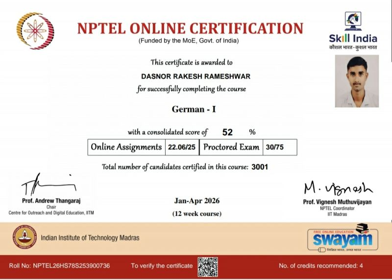
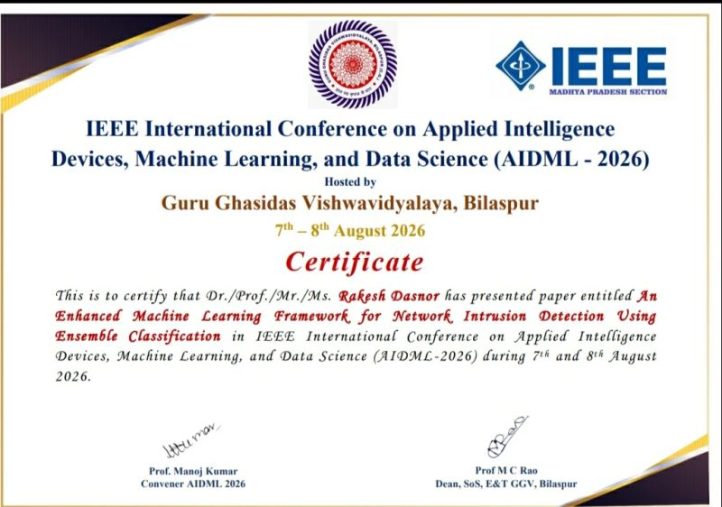

# Certificates & Achievements

Welcome to my certificates and achievements portfolio. This repository showcases my certifications, academic learning, and research paper presentation.

---

## 1. NPTEL Deep Learning Certificate

**[View Deep Learning Certificate](NPTEL-Deep-Learning-Certificate.jpg)**

- **Course:** Deep Learning
- **Issuing Organization:** NPTEL – IIT Kharagpur
- **Platform:** SWAYAM
- **Duration:** 12 Weeks
- **Completion Period:** January–April 2026
- **Score:** 55%
- **Recommended Credits:** 4

### Description

Successfully completed the 12-week NPTEL Deep Learning course offered through IIT Kharagpur.

---

## 2. NPTEL German I Certificate

**[View German I Certificate](NPTEL-German-I-Certificate.jpg)**

- **Course:** German I
- **Issuing Organization:** NPTEL – IIT Madras
- **Platform:** SWAYAM
- **Duration:** 12 Weeks
- **Completion Period:** January–April 2026
- **Score:** 52%
- **Recommended Credits:** 4

### Description

Successfully completed the 12-week NPTEL German I course offered through IIT Madras.

---

## 3. IEEE AIDML 2026 – Research Paper Presentation Certificate

**[View IEEE AIDML 2026 Certificate](IEEE-AIDML-2026-Research-Paper-Presentation.jpg)**

- **Conference:** IEEE International Conference on Applied Intelligence Devices, Machine Learning, and Data Science (AIDML-2026)
- **Host Institution:** Guru Ghasidas Vishwavidyalaya, Bilaspur
- **Conference Dates:** August 7–8, 2026
- **Achievement:** Research Paper Presentation
- **Research Paper Title:** *An Enhanced Machine Learning Framework for Network Intrusion Detection Using Ensemble Classification*

### Description

Presented a research paper on an enhanced machine learning framework for network intrusion detection using ensemble classification at AIDML-2026.

---

## Areas of Interest

- Python
- Data Analytics
- Machine Learning
- Deep Learning
- Network Security
